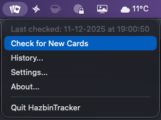
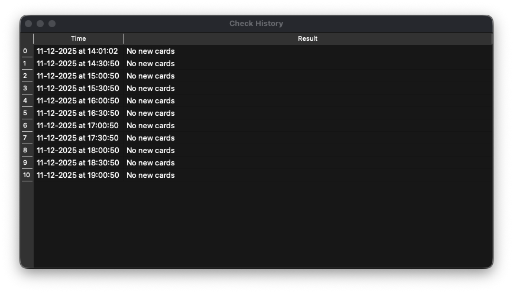

# User Guide

## Installation

Only macOS is supported.

1. Download `HazbinTracker-<version>-macos-<arch>.zip` from the
   [latest release](https://github.com/sowwic/hazbin_tracker/releases/latest).
2. Unzip it and move `HazbinTracker.app` to your Applications folder.
3. Launch it. If macOS refuses to open the app because it is from an unidentified
   developer, right click it and choose **Open**.

The app has no Dock icon and no window. It lives in the menu bar, and only one copy runs at
a time.

## The tray menu

Once the app is running this icon appears in the menu bar:

Clicking it opens a menu with:

* **Last checked**: when the last check ran.
* **Check for New Cards**: run a check now. A manual check tells you when it found nothing
  or failed.
* **History...**: the results of previous checks.
* **Settings...**: the settings editor, see [Settings](settings.md).
* **About...**
* **Quit**

Checks also run in the background, by default every 60 minutes. When new cards are found a
notification is shown, and clicking it opens the Hazbin Hotel store in your browser.

If 5 checks in a row fail (for example the store is blocking requests), the app shows a
warning that new cards may be missed until the problem is resolved.

### Check History

The history dialog lists the checks that ran in the background, and what each of them found.

## Where the files are

Everything lives in `~/.config/HazbinTracker` (or `$XDG_CONFIG_HOME/HazbinTracker` when that
is set):

| File | Content |
| --- | --- |
| `config.json` | Your settings, see [Settings](settings.md) |
| `track_data.json` | The cards seen by the last check and the time it ran |
| `check_history.json` | The check history shown by the history dialog |
| `hazbin.log` | Application log, useful when reporting a problem |

Versions before the move to this location stored these in
`~/Library/Application Support/HazbinTracker`. The files are moved to the new location the
first time the app starts.

## More

* [Settings](settings.md)
* [Pushover notifications](pushover.md)
