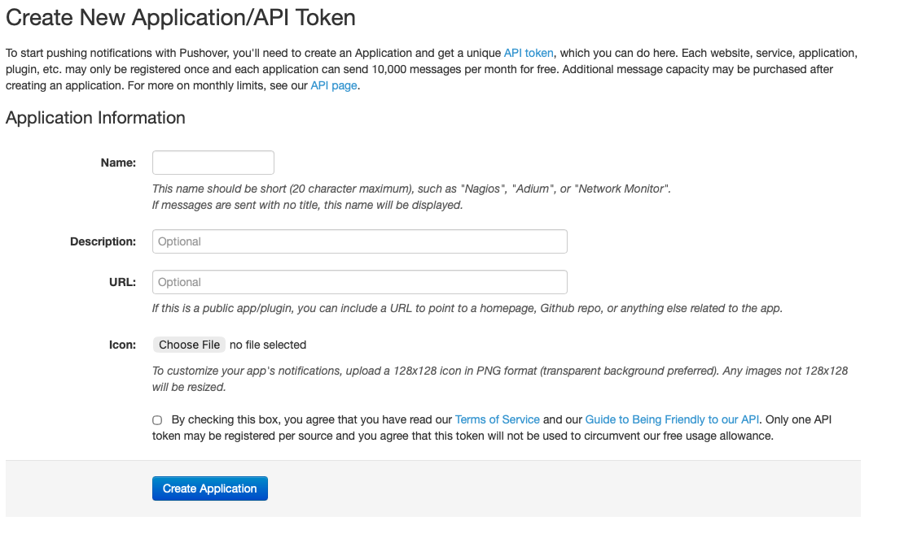

# Pushover notifications

To receive push notifications on your phone:

1. Register a new application on the [Pushover website](https://pushover.net/apps/build).
   This gives you an **API token**.
2. Open **Settings...** from the tray menu and set `pushover.app_key` to that API token and
   `pushover.user_key` to your user key (shown on the front page of the Pushover website).
3. Set `pushover.enabled` to `true` and save.
4. Install the Pushover app on your phone.

You will now get a push notification when new cards are published, along with the desktop one.

Pushover apps:

* [App Store](https://apps.apple.com/gb/app/pushover-notifications/id506088175)
* [Play Store](https://play.google.com/store/apps/details?id=net.superblock.pushover&hl=en_GB&pli=1)

## Testing the notifications

1. Quit the app.
2. In `~/.config/HazbinTracker/track_data.json` set `last_check_time` to a much older date.
3. Launch the app and run **Check for New Cards** from the tray menu.
